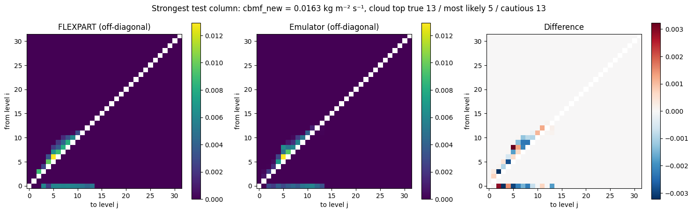

# FLEXPART convection emulator — Phase 1 of a hybrid physics–ML FLEXPART

A small set of neural networks that reproduces the **convection scheme of the Lagrangian particle
dispersion model FLEXPART** (Emanuel & Živković-Rothman scheme), trained on FLEXPART's own Fortran code
and real ERA5 atmospheric columns.

This is **Phase 1** of a larger plan: keep FLEXPART's simple equations as exact physics and replace only
the complex or empirical modules with small trained models. See [PLAN.md](PLAN.md) for the whole plan and
[report/phase1_report.pdf](report/phase1_report.pdf) for the written record of Phase 1.

## Results in brief (v5, test data never seen in training)

| Check | Indian Ocean 2023 | Tropical Atlantic 2023 (unseen region) |
|---|---|---|
| Convection detected (gate F1) | 0.989 | 0.976 |
| Mass-flux profile, worst level | 10.9 % | 7.9 % |
| Per-column off-diagonal error (median) | 34 % | 38 % |
| Particle test (median Wasserstein distance) | 0.014 hPa | 0.013 hPa |
| New cloud-base mass flux (R²) | 0.990 | 0.965 |
| Mass conservation | exact | exact |

Speed: only 1.3–1.6× faster than the Fortran scheme on CPU — the scheme is cheaper than expected, so the
value of this approach lies in accuracy and in learning better physics later (Phase 3), not in speed.

## How it works

1. **Teacher:** `CONVECT` and `TLIFT` are copied out of FLEXPART 11's `conv_mod.f90`, the `ERROR STOP` is
   patched into a flag, and the scheme is compiled with `gfortran` into a library callable from Python
   (`ctypes`). A wrapper mirrors FLEXPART's `calcmatrix` and converts the mass matrix to fractions.
2. **Data:** ERA5 temperature and humidity on 32 pressure levels (1000–10 hPa), tropical Indian Ocean
   2019–2023 (train 2019–2021, validation 2022, test 2023); tropical Atlantic 2023 as a held-out region.
   The scheme has memory (cloud-base mass flux), so each column gets a random number of spin-up calls.
3. **Four small models:** gate (convection yes/no) → cloud top (cautious, 95 % confidence) →
   redistribution matrix (row-wise softmax: mass conserved exactly; air above the cloud top masked out)
   → new cloud-base mass flux.
4. **Training:** KL divergence with rows weighted by the air they move, then a short fine-tuning stage
   with a relative mass-flux error term.
5. **Export:** one TorchScript module for coupling into FLEXPART (Phase 2, via FTorch).

## Repository

| Path | Contents |
|---|---|
| `notebooks/` | Google Colab notebooks, v1–v5 (each version's changes are described at its top) |
| `scripts/download_era5.py` | Downloads the ERA5 columns (Copernicus account needed) |
| `scripts/heldout_atlantic_eval.py` | Held-out region test (run inside the v5 notebook) |
| `results/` | Validation results of every version (JSON) |
| `figures/` | Validation figures of every version |
| `report/` | LaTeX report of Phase 1 and its PDF |
| `PLAN.md` | Whole project plan, Phase 1 objectives and outcome |

## Running it

1. Download the data with `scripts/download_era5.py` (or the cells in the notebooks) into
   `MyDrive/era5_phase1/` and `MyDrive/era5_heldout/`.
2. Open `notebooks/05_v5_era5_cautious_top_flux_finetune.ipynb` in Google Colab, choose a T4 GPU runtime,
   and run all cells. It downloads FLEXPART, builds the convection library, labels the columns, trains,
   validates and exports the model.

## Development history

| Version | Data | Key change | Main lesson |
|---|---|---|---|
| v1 | synthetic | Pipeline with a simplified stand-in scheme | Pipeline works |
| v2 | synthetic | FLEXPART's real scheme as teacher | Good on average, but blurred per column |
| v3 | synthetic | Cloud-top model + masking | Masking fixes the boundary-layer bias; a flux loss from the start collapses training |
| v4 | ERA5 | Real data, row weighting by moved air | Generalises in time; flux overestimated; cloud-top misses are costly |
| v5 | ERA5 | Cautious cloud top, flux fine-tuning, more epochs | Meets the accuracy targets, also in an unseen region |

## Acknowledgements and licence

FLEXPART is developed by its community (Stohl et al. 2005; Pisso et al. 2019; Bakels et al. 2024) and is
not included here; the notebooks download it at run time. ERA5 data: Copernicus Climate Change Service
(Hersbach et al. 2020), CC-BY licence. Code in this repository: MIT licence (see `LICENSE`).
