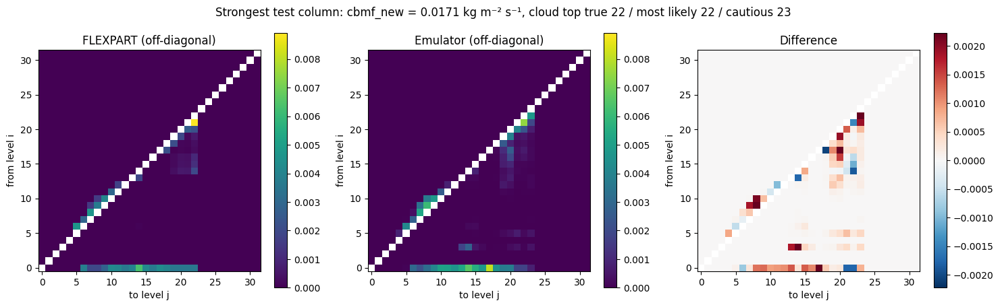

# FLEXPART convection emulator — Phase 1 of a hybrid physics–ML FLEXPART

A small set of neural networks that reproduces the **convection scheme of the Lagrangian particle
dispersion model FLEXPART** (Emanuel & Živković-Rothman scheme), trained on FLEXPART's own Fortran code
and real ERA5 atmospheric columns.

This is **Phase 1** of a larger plan: keep FLEXPART's simple equations as exact physics and replace only
the complex or empirical modules with small trained models. See [PLAN.md](PLAN.md) for the whole plan and
[report/phase1_report.pdf](report/phase1_report.pdf) for the written record of Phase 1.

## Results in brief (v6, test data never seen in training)

| Check | Indian Ocean 2023 | Tropical Atlantic 2023 (unseen region) |
|---|---|---|
| Convection detected (gate F1) | 0.994 | 0.981 |
| Mass-flux profile, worst significant level | 4.7 % | 11.2 % (at a level with 1 % of the peak flux) |
| Mass-flux profile, worst level carrying ≥ 10 % of the peak flux | 4.6 % | 9.5 % |
| Per-column off-diagonal error (median) | 29 % | 33 % |
| Per-column off-diagonal error (strongest 10 %) | 29 % | 30 % |
| Particle test (median Wasserstein distance) | 0.013 hPa | 0.011 hPa |
| New cloud-base mass flux (R²) | 0.991 | 0.978 |
| Mass conservation | exact | exact |

Columns whose surface pressure is below 1000 hPa (levels below ground, mostly land) are excluded:
about 1.9 % in the Indian Ocean, 10 % in the Atlantic.

Speed: only 1.3–1.6× faster than the Fortran scheme on CPU — the scheme is cheaper than expected, so the
value of this approach lies in accuracy and in learning better physics later (Phase 3), not in speed.

## Surface pressure and the Atlantic gap (v6)

v6 uses real ERA5 surface pressure (input feature, and bottom layer boundary of FLEXPART's convection, as
in FLEXPART's `calcmatrix`) and a gate threshold of 0.3. Against v5 it improves almost every check; the
mass-flux profile is the exception in the Atlantic. A diagnostic (`scripts/flux_diagnostic.py`,
`results/v6_flux_diagnostic.json`) shows:

- The Atlantic's headline 11.2 % comes from a level near the cloud top (137.5 hPa) that carries only 1 % of
  the peak flux. Where the flux is at least 10 % of its peak, the worst error is 9.5 % (Indian Ocean 4.6 %).
- There is a real bias: between 860 and 375 hPa the emulator lifts 6–9 % too much air in the Atlantic
  (3–4.6 % in the Indian Ocean).
- 56 % of Atlantic columns have a surface pressure outside the training range (median 1013.8 vs 1009.4 hPa),
  and their error is much larger (28.6 % vs 9.8 %). But clipping the surface-pressure *input* to the
  training range barely helps (12.3 % → 11.9 %): the input is not the cause.
- Higher pressure marks a different regime: Atlantic convection is shallower (its upward flux halves by
  860 hPa), which the Indian Ocean training data rarely contains. The remedy is more varied training regions.

## Gate threshold test

The saved v5 model was re-evaluated with gate thresholds from 0.5 to 0.2, without retraining
(`scripts/gate_threshold_test.py`; results in `results/v5_gate_threshold_test.json`).

| Threshold | Missed (Indian / Atlantic) | False alarms (Indian / Atlantic) | Gate F1 (Indian / Atlantic) | Mass-flux error (Indian / Atlantic) |
|---|---|---|---|---|
| 0.5 | 510 / 643 | 53 / 503 | 0.989 / 0.976 | 11.2 % / 7.9 % |
| 0.3 | 379 / 489 | 87 / 565 | 0.991 / 0.978 | 11.1 % / 8.1 % |
| 0.2 | 311 / 401 | 112 / 616 | 0.992 / 0.979 | 11.1 % / 8.2 % |

- 91–98 % of the missed columns are weak convection (lowest quarter of the new cloud-base mass flux).
- Lowering the threshold to 0.2 recovers about 40 % of the misses, at roughly one extra false alarm each.
- Transport checks (mass flux, per-column error, cloud-base mass flux) change by less than 0.3 percentage points:
  weak convection moves little air, so the remaining gate errors matter little for transport.
- Recommended threshold: **0.3**. The misses that remain need a better-trained gate (e.g. more weight on weak
  convection), not a lower threshold.

## How it works

1. **Teacher:** `CONVECT` and `TLIFT` are copied out of FLEXPART 11's `conv_mod.f90`, the `ERROR STOP` is
   patched into a flag, and the scheme is compiled with `gfortran` into a library callable from Python
   (`ctypes`). A wrapper mirrors FLEXPART's `calcmatrix` and converts the mass matrix to fractions.
2. **Data:** ERA5 temperature and humidity on 32 pressure levels (1000–10 hPa), tropical Indian Ocean
   2019–2023 (train 2019–2021, validation 2022, test 2023); tropical Atlantic 2023 as a held-out region.
   The scheme has memory (cloud-base mass flux), so each column gets a random number of spin-up calls.
3. **Four small models:** gate (convection yes/no) → cloud top (cautious, 95 % confidence) →
   redistribution matrix (row-wise softmax: mass conserved exactly; air above the cloud top masked out)
   → new cloud-base mass flux.
4. **Training:** KL divergence with rows weighted by the air they move, then a short fine-tuning stage
   with a relative mass-flux error term.
5. **Export:** one TorchScript module for coupling into FLEXPART (Phase 2, via FTorch).

## Repository

| Path | Contents |
|---|---|
| `notebooks/` | Google Colab notebooks, v1–v6 (each version's changes are described at its top) |
| `scripts/download_era5.py` | Downloads the ERA5 columns (Copernicus account needed) |
| `scripts/heldout_atlantic_eval.py` | Held-out region test for v5 (built into the v6 notebook) |
| `scripts/gate_threshold_test.py` | Gate threshold test (run inside the v5 notebook) |
| `scripts/flux_diagnostic.py` | Surface-pressure and per-level mass-flux diagnostic (run inside the v6 notebook) |
| `results/` | Validation results of every version (JSON) |
| `figures/` | Validation figures of every version |
| `report/` | LaTeX report of Phase 1 and its PDF |
| `PLAN.md` | Whole project plan, Phase 1 objectives and outcome |

## Running it

1. Download the data with `scripts/download_era5.py` (or the cells in the notebooks) into
   `MyDrive/era5_phase1/` and `MyDrive/era5_heldout/`, and ERA5 surface pressure (single levels, same
   dates, areas and grid) into `MyDrive/era5_surface_pressure/` as `sp_YYYY.nc` and `sp_atlantic_2023.nc`.
2. Open `notebooks/06_v6_surface_pressure.ipynb` in Google Colab, choose a T4 GPU runtime,
   and run all cells. It downloads FLEXPART, builds the convection library, labels the columns, trains,
   validates and exports the model.

## Development history

| Version | Data | Key change | Main lesson |
|---|---|---|---|
| v1 | synthetic | Pipeline with a simplified stand-in scheme | Pipeline works |
| v2 | synthetic | FLEXPART's real scheme as teacher | Good on average, but blurred per column |
| v3 | synthetic | Cloud-top model + masking | Masking fixes the boundary-layer bias; a flux loss from the start collapses training |
| v4 | ERA5 | Real data, row weighting by moved air | Generalises in time; flux overestimated; cloud-top misses are costly |
| v5 | ERA5 | Cautious cloud top, flux fine-tuning, more epochs | Meets the accuracy targets, also in an unseen region |
| v6 | ERA5 | Real surface pressure, below-ground columns excluded, gate threshold 0.3 | Best Indian Ocean results; Atlantic flux gap traced to a convection-regime shift |

## Acknowledgements and licence

FLEXPART is developed by its community (Stohl et al. 2005; Pisso et al. 2019; Bakels et al. 2024) and is
not included here; the notebooks download it at run time. ERA5 data: Copernicus Climate Change Service
(Hersbach et al. 2020), CC-BY licence. Code in this repository: MIT licence (see `LICENSE`).
